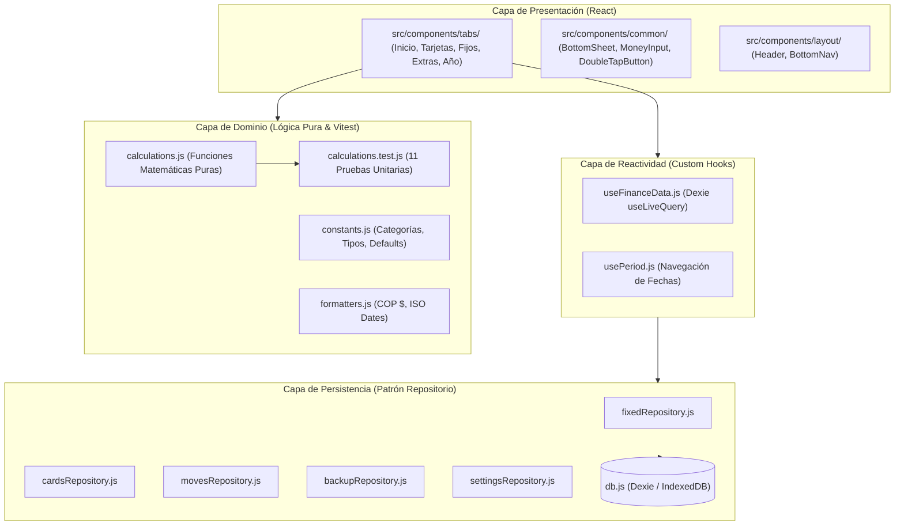

<div align="center">
  
</div>

# 🏛️ Saggio · Cuentas al día

> **Control sabio de finanzas personales, flujo quincenal (15 y 30), pagos fijos y tarjetas de crédito.**  
> Aplicación web progresiva (PWA) de alto rendimiento, orientada a dispositivos móviles (*mobile-first*) con arquitectura limpia (*Clean Architecture*) y persistencia local privada (*Offline-First* con IndexedDB).

[](package.json)
[](LICENSE)
[](https://react.dev/)
[](https://vitejs.dev/)
[](https://dexie.org/)
[](https://vitest.dev/)
[](index.html)

---

## 📋 Tabla de Contenidos

- [💡 ¿Por qué Saggio?](#-por-qué-saggio)
- [✨ Características Principales](#-características-principales)
- [🏛️ Arquitectura del Software](#️-arquitectura-del-software)
- [🛠️ Stack Tecnológico](#️-stack-tecnológico)
- [📁 Estructura del Proyecto](#-estructura-del-proyecto)
- [🧪 Pruebas Unitarias](#-pruebas-unitarias)
- [🚀 Instalación y Puesta en Marcha](#-instalación-y-puesta-en-marcha)
- [📚 Documentación del Sistema](#-documentación-del-sistema)
- [📄 Licencia](#-licencia)

---

## 💡 ¿Por qué Saggio?

La inmensa mayoría de aplicaciones de finanzas personales fallan porque asumen un mes calendario plano del 1 al 31 y obligan a registrar manualmente cada café o compra menor.

**Saggio** (del italiano *"sabio, prudente, sensato"*) aborda la realidad financiera de las personas que cobran por quincenas:
1. **Quincena del 15:** Destinada a cubrir las obligaciones y gastos del **16 a fin de mes**.
2. **Quincena del 30:** Destinada a cubrir las obligaciones y servicios del **1 al 14 del mes siguiente**.

Con Saggio nunca se pasa una fecha de pago, tus cuentas están al día y tienes una radiografía exacta de en qué se va tu dinero.

---

## ✨ Características Principales

### 📅 Flujo Quincenal Inteligente
- **Cálculo de flujo de caja real:** Diferenciación matemática estricta entre la Quincena 15 y la Quincena 30.
- **Soporte de ingresos periódicos:** Sueldo quincenal base, apoyos por tiempo limitado (ej. Apoyo SENA) y aportes familiares.
- **Historial inmutable:** Modificar el sueldo en un año futuro no altera ni corrompe los balances históricos pasados.

### 📌 Obligaciones Fijas y Servicios
- **Reordenamiento dinámico e intuitivo:**
  - `✓ Lo que vas pagando` (sube automáticamente arriba con fecha de pago).
  - `○ En ceros / Por definir ($0)` (servicios variables como gas o luz, con pago rápido en 2 toques).
  - `⏳ Por pagar` (compromisos pendientes abajo para no perderlos de vista).
- **Protección contra borrado accidental:** Botones de doble toque (*double-tap*) para eliminar registros sin confirmaciones molestas.

### 💳 Control Integral de Tarjetas de Crédito
- **Visualización bancaria elegante:** Tarjetas con diseño estilizado, banco emisor, franquicia y últimos 4 dígitos.
- **Distinción entre cuota y deuda total:** Pago de la cuota del mes vs. abonos extraordinarios que descuentan directamente el capital de la deuda.
- **Registro de nuevos cargos:** Capacidad de prestar o cargar consumos sumando automáticamente al saldo pendiente.

### 📊 Radiografía Anual de Gastos
- **Desglose interactivo tipo acordeón:** Toca cualquier categoría (*Servicios*, *Alimentación*, *Tarjetas*, etc.) para expandir el desglose exacto de cada sub-ítem (*Gas*, *Luz*, *Comida*), porcentaje de gasto y frecuencia anual.

### 🛡️ Privacidad Offline-First
- **Sin bancos intermediarios ni servidores externos:** Toda la información vive cifrada y almacenada localmente en tu propio dispositivo mediante IndexedDB.
- **Copias de seguridad portables:** Exportación e importación de respaldos en formato JSON con validación de integridad.

---

## 🏛️ Arquitectura del Software

El sistema sigue los principios de **Clean Architecture** y **Separation of Concerns (SoC)**, asegurando cero código espagueti:



---

## 🛠️ Stack Tecnológico

| Capa | Tecnología | Propósito |
| :--- | :--- | :--- |
| **Frontend Framework** | **React 18.3** | Componentes declarativos y ciclo de vida moderno |
| **Build Tool & Dev** | **Vite 5.4** | Servidor de desarrollo instantáneo y empaquetado optimizado |
| **Persistencia Local** | **Dexie 4.0** | Wrapper reactivo de alto rendimiento sobre IndexedDB con índices |
| **Iconografía** | **Lucide React** | Iconos SVG minimalistas y de peso ultra-ligero |
| **Testing Suite** | **Vitest 2.1** | Suite de pruebas unitarias ultrarrápida compatible con ESM |
| **Diseño / Estilos** | **CSS Variables nativo** | Design system oscuro, mobile-first, sin frameworks CSS pesados |
| **UX Móvil** | **Visual Viewport API** | Adaptación automática a teclado numérico virtual (`interactive-widget`) |

---

## 📁 Estructura del Proyecto

```
saggio/
├── _docs/                                # Documentación formal de requerimientos e ingeniería
│   └── requisitos-funcionales.md        # Especificación detallada de RF (P0 a P3)
├── public/                               # Archivos estáticos y manifiesto PWA
│   ├── icon.svg                          # Icono oficial de la aplicación
│   └── manifest.json                     # Configuración PWA para instalación móvil
├── src/
│   ├── core/                             # LÓGICA DE NEGOCIO PURA (Sin dependencias de UI/DB)
│   │   ├── calculations.js               # Algoritmos de quincenas, deudas y desgloses
│   │   ├── calculations.test.js          # Pruebas unitarias en Vitest
│   │   ├── constants.js                  # Categorías, colores, períodos
│   │   └── formatters.js                 # Formato COP $ y fechas locales
│   ├── data/                             # PERSISTENCIA (Patrón Repositorio)
│   │   ├── db.js                         # Esquema de tablas e índices Dexie
│   │   └── repositories/                 # Repositorios aislados por entidad
│   │       ├── backupRepository.js       # Exportación/importación JSON
│   │       ├── cardsRepository.js        # Operaciones de tarjetas y abonos
│   │       ├── fixedRepository.js        # Operaciones de gastos fijos y pagos $0
│   │       ├── movesRepository.js        # Movimientos extras
│   │       └── settingsRepository.js     # Configuración y sueldos
│   ├── hooks/                            # REACTIVIDAD Y ESTADO
│   │   ├── useFinanceData.js             # Suscripción en vivo a IndexedDB
│   │   └── usePeriod.js                  # Selector de mes y año
│   ├── components/                       # INTERFAZ DE USUARIO
│   │   ├── common/                       # Componentes atómicos (BottomSheet, MoneyInput)
│   │   ├── layout/                       # Estructura principal (Header, BottomNav)
│   │   └── tabs/                         # Módulos principales por pestaña
│   │       ├── InicioTab/                # Tablero de control quincenal
│   │       ├── FijosTab/                 # Lista y gestión de fijos
│   │       ├── TarjetasTab/              # Visualizador y pagos de tarjetas
│   │       ├── ExtrasTab/                # Movimientos extraordinarios
│   │       └── AnioTab/                  # Balance anual y desglose interactivo
│   ├── styles/                           # ESTILOS GLOBALES
│   │   └── global.css                    # Design tokens y layout responsivo
│   ├── App.jsx                           # Componente raíz y navegación
│   └── main.jsx                          # Punto de entrada de la aplicación
├── index.html                            # Entrada HTML y configuración de Viewport
├── package.json                          # Metadatos y scripts del proyecto
└── vite.config.js                        # Configuración de compilación Vite y Vitest
```

---

## 🧪 Pruebas Unitarias

El sistema cuenta con un suite de pruebas automatizadas que validan matemáticamente todas las reglas financieras antes de cada despliegue:

```bash
# Ejecutar todas las pruebas unitarias
pnpm test
```

### Casos de prueba validados:
- ✅ Descuento de saldo de tarjetas ante cuotas regulares vs. abonos a capital.
- ✅ Cargo o préstamo nuevo que suma a la deuda actual de la tarjeta.
- ✅ Ciclo real de quincenas: la quincena 15 cubre del 16 a fin de mes; la quincena 30 cubre del 1 al 14.
- ✅ Preservación inmutable del histórico de sueldos ante cambios en períodos futuros.
- ✅ Pagos en ceros ($0) de servicios públicos con monto variable en el mes corriente.
- ✅ Desglose y árbol de conceptos anuales con cálculo de porcentaje y frecuencia.

---

## 🚀 Instalación y Puesta en Marcha

### Prerrequisitos
- Node.js ≥ 18.0.0
- pnpm ≥ 9.0.0 (o npm / yarn)

### Pasos de ejecución local

```bash
# 1. Clonar el repositorio
git clone https://github.com/tu-usuario/saggio.git
cd saggio

# 2. Instalar dependencias
pnpm install

# 3. Iniciar servidor de desarrollo local
pnpm run dev

# 4. Compilar para producción
pnpm run build
```

Accede desde tu navegador en `http://localhost:5173` o conéctate desde tu dispositivo móvil a la IP local para instalar la PWA directamente en la pantalla de inicio.

---

## 📚 Documentación del Sistema

- [Especificación de Requisitos Funcionales (_docs/requisitos-funcionales.md)](_docs/requisitos-funcionales.md)

---

## 👨‍💻 Autor

**Jose Miguel Chico Camacho**  
Desarrollo de Software · Portafolio Profesional SENA ADSO

---

## 📄 Licencia

Este proyecto se distribuye bajo la licencia **MIT**. Consulta el archivo `LICENSE` para más detalles.
Copyright (c) 2026 Jose Miguel Chico Camacho.

